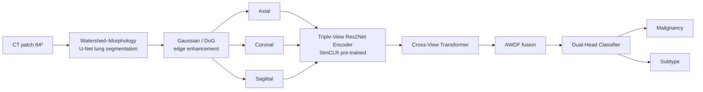

# CLAWS-Net
**Contrastive Learning-Augmented Multi-View Transformer Network for Lung Nodule Classification and Subtype Prediction**

Lung cancer is the leading cause of cancer-related deaths, largely because small or low-contrast nodules are hard to detect early and tumour subtypes are hard to separate. CLAWS-Net classifies lung nodules (benign vs. malignant) and predicts the cancer subtype from CT, using multi-view 3D context and label-efficient contrastive pre-training.

## Architecture



| Module | File | Description |
|---|---|---|
| Lung segmentation | `claws_net/preprocess.py`, `models.UNet` | Marker-controlled watershed + morphology gives a lung prior; a U-Net refines it (`scripts/train_seg.py`). |
| Edge enhancement | `preprocess.gaussian_edge_enhance` | Gaussian denoise + Difference-of-Gaussians band-pass emphasises nodule edges, suppresses noise. |
| SimCLR pre-training | `scripts/pretrain_simclr.py`, `losses.nt_xent` | Label-free contrastive learning of an invariant encoder. |
| Triple-View Res2Net | `models.Res2NetEncoder` | One Res2Net per axial / coronal / sagittal view (2.5D: 3 slices at ±4 voxels as channels). |
| Cross-View Transformer | `models.CrossViewTransformer` | Joint self-attention over all views' tokens with learned view+position embeddings. |
| AWDF | `models.AWDF` | Token attention pooling, per-sample softmax view gating, residual refinement. |
| Dual-Head Classifier | `models.DualHead`, `losses.CompositeLoss` | Malignancy (2-class) + subtype (adenocarcinoma / squamous / other). Composite loss `L = CE_mal + λ·CE_sub`; subtype term used only where a subtype label exists. |

## Datasets
* **LIDC-IDRI** – 1,018 thoracic CTs, four radiologists, >7,000 annotated nodules (malignancy 1–5). Nodules ≥3 mm with ≥3 reader annotations are used; mean malignancy <3 → benign, >3 → malignant, =3 excluded. No subtype labels (malignancy supervision only).
* **LUNGx Challenge (SPIE-AAPM-NCI)** – TCIA collection [`spie-aapm-lung-ct-challenge`](https://www.cancerimagingarchive.net/collection/spie-aapm-lung-ct-challenge/) (DOI 10.7937/K9/TCIA.2015.UZLSU3FL): 70 CT scans (10 `CT-Training-*` calibration + 60 `LUNGx-*` test patients, 12.07 GB) with nodule locations and benign/malignant diagnoses in two Excel files. Used as an **external test set** (never for model selection). Verify the final nodule count and whether histological subtypes exist in the Excel files before quoting them.

Data are not redistributed; download from [TCIA](https://www.cancerimagingarchive.net/) and respect their licences.

## Installation
```bash
git clone <your-repo-url> && cd CLAWS-Net
pip install -r requirements.txt && pip install -e .
```

## Reproduce
```bash
# 1) smoke test on synthetic data (CPU, minutes) – validates the pipeline, NOT a result
python scripts/make_synthetic.py --out data/synthetic --n 160
python scripts/train.py --manifest data/synthetic/manifest.csv --epochs 3 --workers 0 --out results/smoke

# 2) real data
#    ~/.pylidcrc must point to your LIDC-IDRI folder (see scripts/extract_lidc.py)
python scripts/extract_lidc.py --out data/lidc
python scripts/prepare_lungx.py --dicom_root /data/SPIE-AAPM --xlsx CalibrationSet_NoduleData.xlsx TestSet_NoduleData_PublicRelease_wTruth.xlsx --out data/lungx --preview   # inspect data/lungx/preview.png!
python scripts/pretrain_simclr.py --manifest data/lidc/manifest.csv --epochs 100
python scripts/train.py --manifest data/lidc/manifest.csv --external data/lungx/manifest.csv \
       --pretrained checkpoints/simclr_encoder.pt --fold 0 --out results/claws_net_fold0

# 3) everything (5-fold CV + ablations + report)
bash scripts/run_all.sh
```
`scripts/make_report.py` aggregates every run into `results/summary.md` (mean ± std over folds) and `results/all_runs.csv`. Each run folder holds `metrics.json`, `pred_*.csv`, `roc.png`, `cm_*.png`, `history.png`.

**Evaluation protocol.** Patient-wise stratified 5-fold CV (no patient appears in more than one split); the decision threshold is chosen on the validation fold (Youden J) and then frozen for test/external evaluation; 95 % bootstrap CI for AUC; ablations: no SimCLR, no cross-view transformer, no AWDF, single views.

## Results
> Fill from `results/summary.md` after running `scripts/run_all.sh`. Numbers must come from your own runs.

| Model | Accuracy | Sensitivity | Specificity | AUC | Subtype acc. |
|---|---|---|---|---|---|
| CLAWS-Net | | | | | |

## Tests
```bash
python -m pytest tests -q   # model tests are skipped automatically if PyTorch is missing
```

## Limitations
Research code, not a medical device and not validated for clinical use. LUNGx is small (73 nodules) so external-set estimates have wide confidence intervals; subtype labels are scarce, so subtype results should be interpreted cautiously.

## Citation
```
R. K. Mahendran et al., "CLAWS-Net: A Contrastive Learning-Augmented Multi-View Transformer Network for Lung Nodule Classification and Subtype Prediction", 2026.
```
